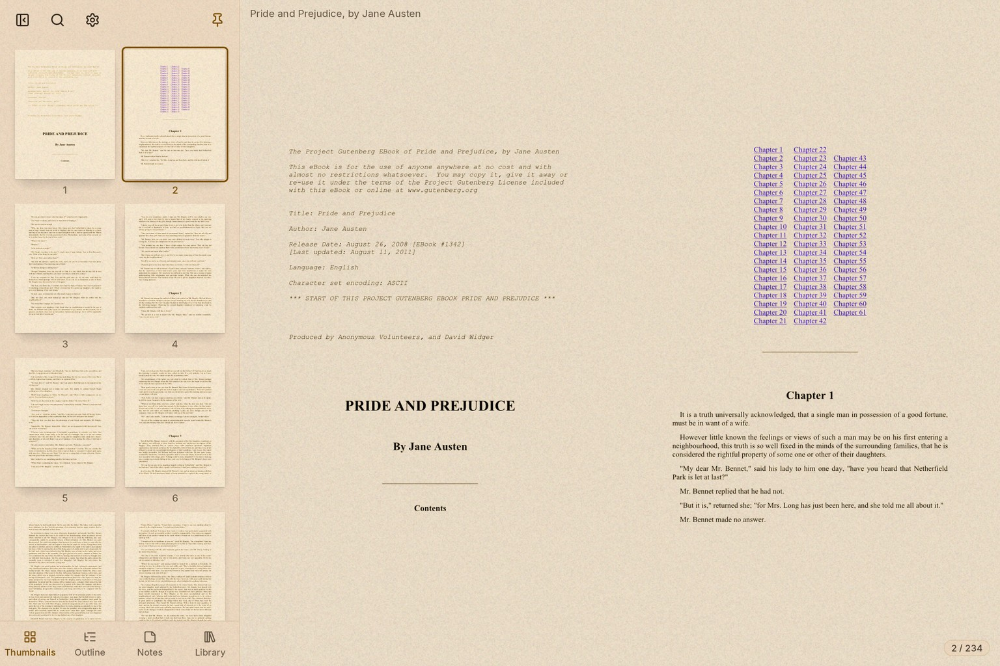
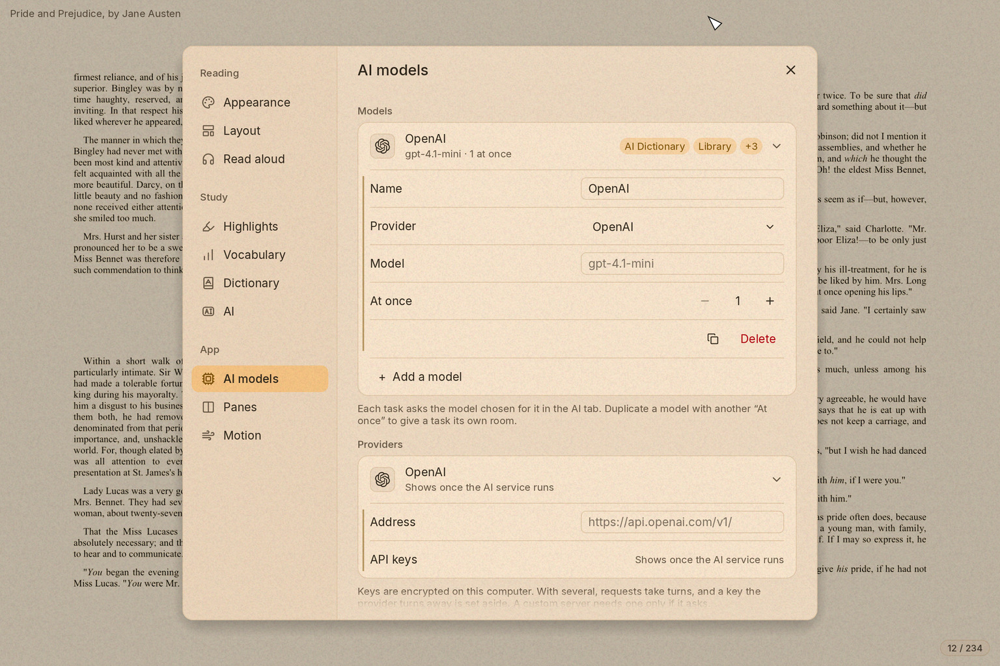
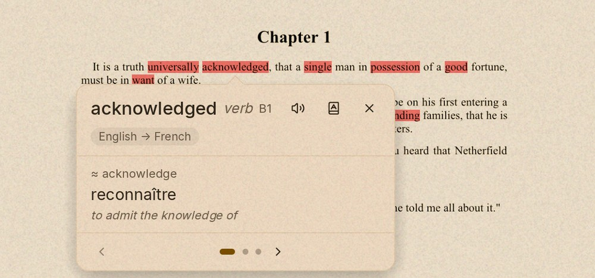
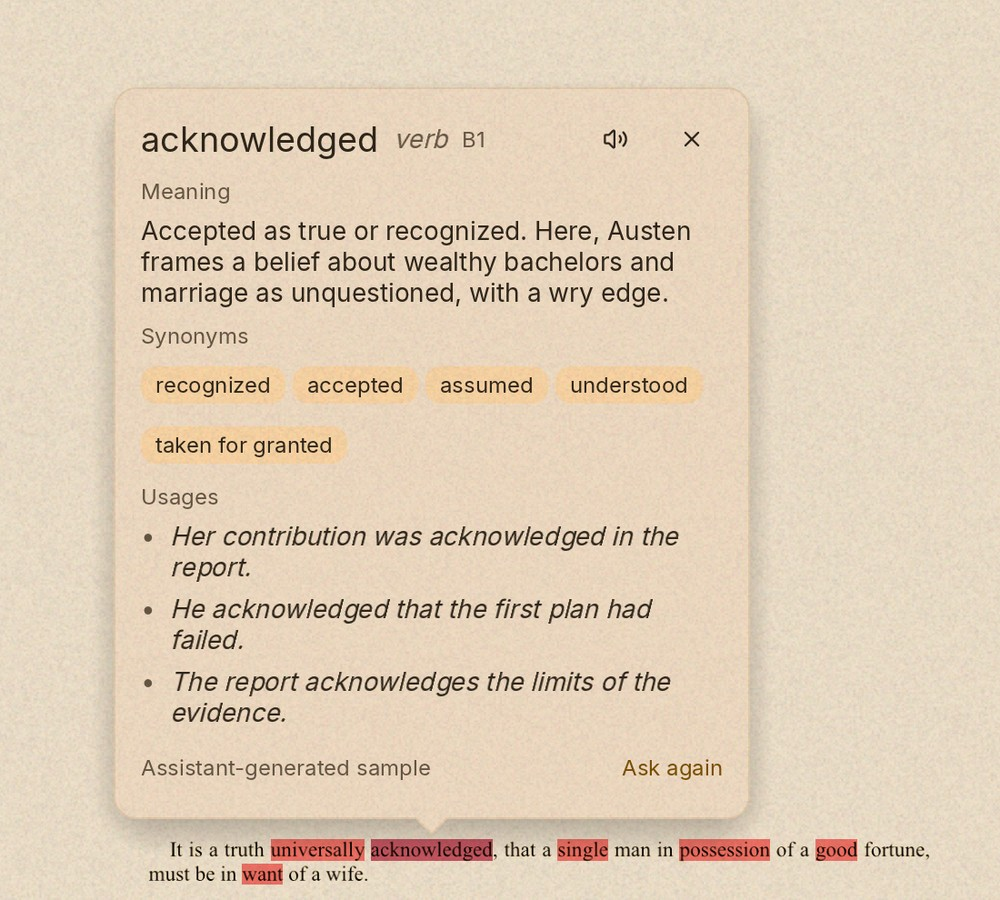
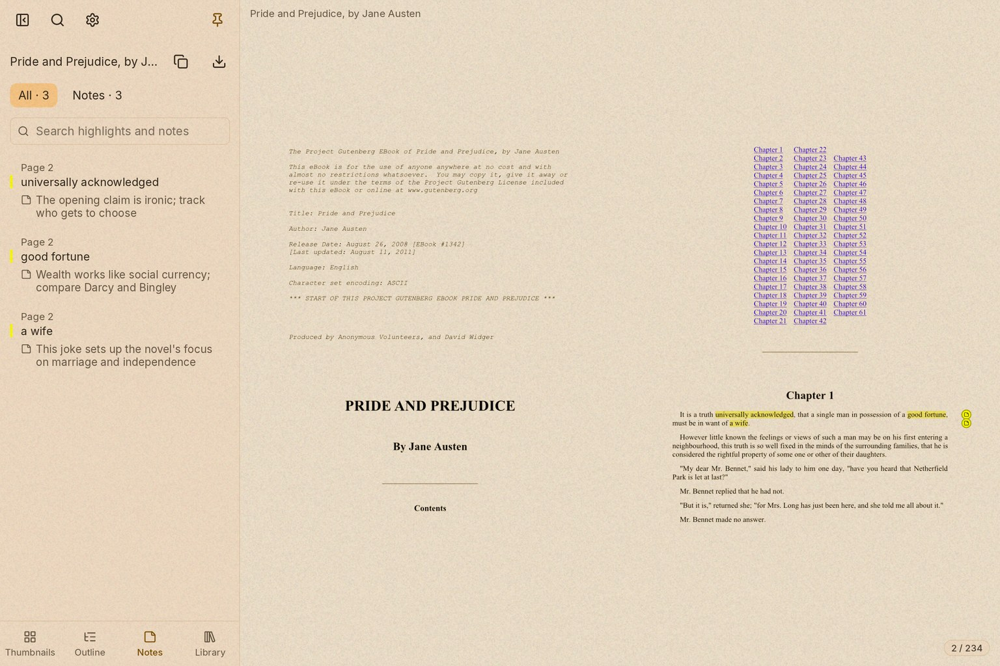
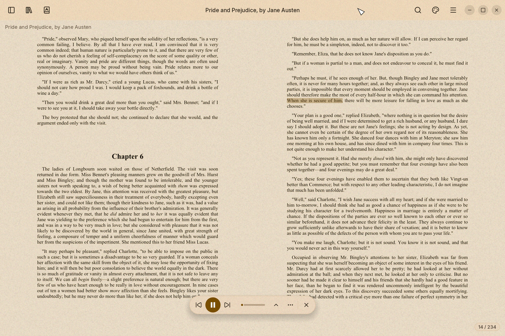
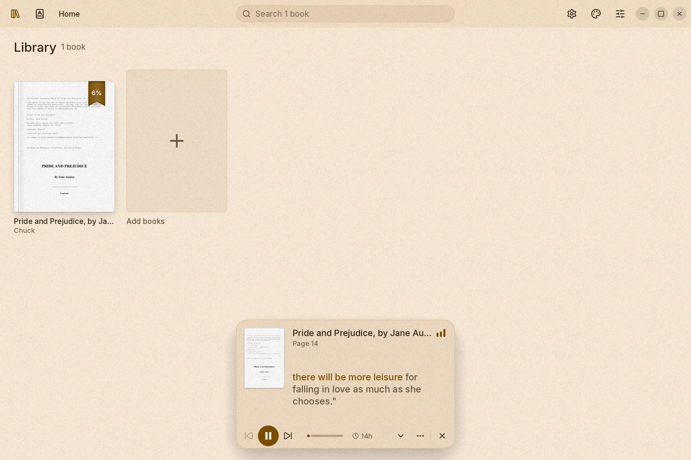
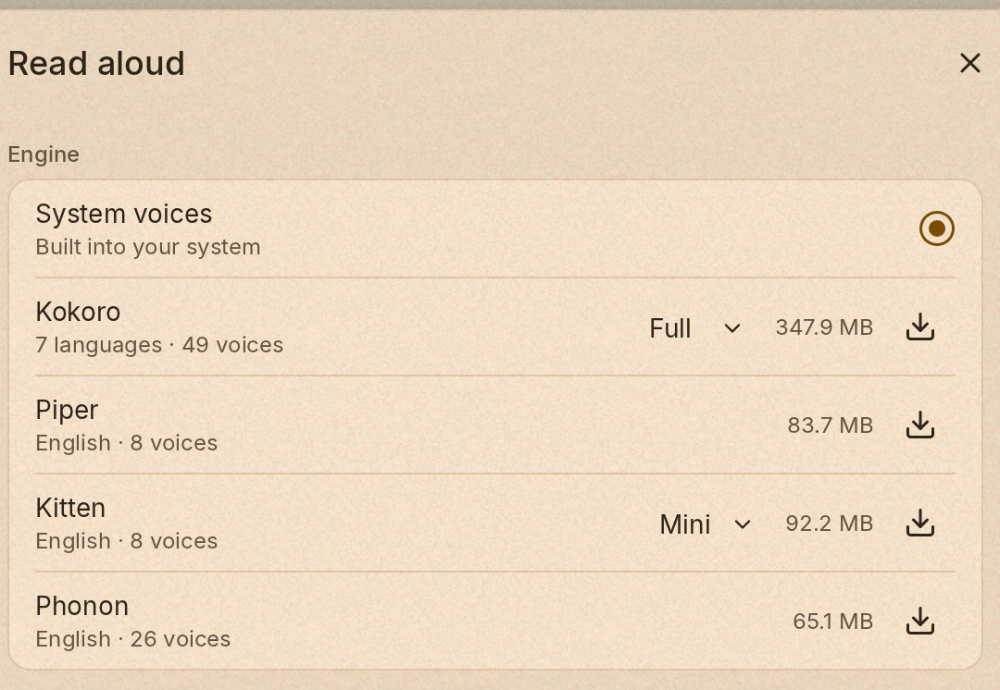
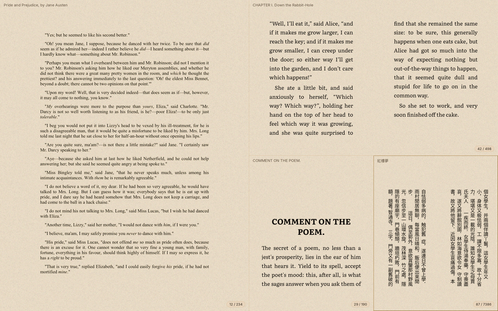
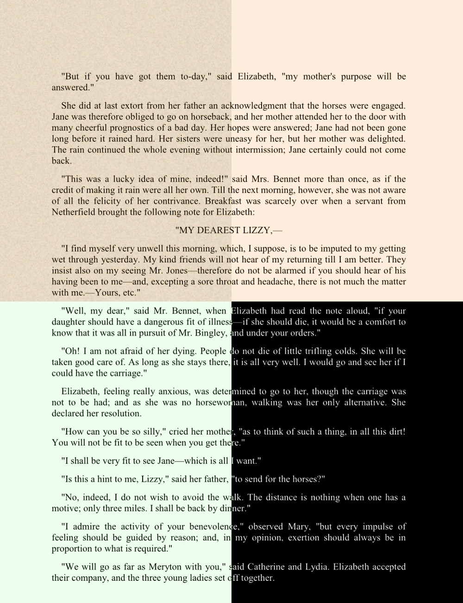

<p align="center">
  
</p>

<h1 align="center">Mareader</h1>

<p align="center"><strong>A reader for PDFs and EPUBs, shaped around the way you read.</strong></p>

<p align="center">
  Open a quiet page or build a four-pane reading desk. Keep notes, listen as you read,
  and bring in AI when it helps.
</p>

<p align="center">
  <a href="https://github.com/codewiththiha/mareader2/releases/latest">Latest release</a>
  · <a href="https://github.com/codewiththiha/mareader2/releases">All releases</a>
</p>

## Features

| Feature | What it does | Highlight |
| --- | --- | --- |
| PDF and EPUB | Read, search, follow links, and move through pages, spreads, or continuous scroll. | [Reading spread](docs/screenshots/readme/reader-default.jpg) · [Vertical Chinese EPUB](docs/screenshots/readme/chinese-vertical-epub.jpg) |
| Four-pane workspace | Keep up to four books open side by side to compare text and references. | [Four panes](docs/screenshots/readme/four-panes.jpg) |
| Notes and highlights | Mark a word or passage, add a note, and find it again in the Notes panel. | [Multiple notes](docs/screenshots/readme/notes-panel.jpg) |
| Read aloud | Keep playback controls close while reading, and continue playback in the Library. | [Reader playback](docs/screenshots/readme/read-aloud-playing.jpg) · [Library player](docs/screenshots/readme/read-aloud-library.jpg) |
| Local voice models | Browse Kokoro, Piper, Kitten, and Phonon engines, build choices, voice counts, and download sizes. | [Model catalogue](docs/screenshots/readme/local-voice-settings.jpg) |
| AI reading tools | Explain words in context, summarize, translate, simplify, and organize a library. | [AI guide](docs/assist.md) |
| CEFR vocabulary | Shade words above a chosen level and open an in-context dictionary or AI lookup. | [Dictionary lookup](docs/screenshots/readme/cefr-word-lookup.jpg) · [AI-powered lookup](docs/screenshots/readme/cefr-ai-lookup.jpg) · [Study guide](docs/study.md) |
| AI model setup | Choose providers and models by task, including hosted and OpenAI-compatible local services. | [Model settings](docs/screenshots/readme/ai-model-setup.jpg) · [AI guide](docs/assist.md) |
| Theme presets | Customize modes, tints, textures, grain, and individual panes. | [Theme comparison](docs/screenshots/readme/themes-comparison.jpg) |

## Screenshots

### Reading surface



### AI model setup



### CEFR highlighting and lookup



#### AI-powered lookup



### Notes that stay with the book



### Read aloud





Playback continues after switching to Library.

### Local voice models



### Four panes



### Chinese EPUB in vertical layout


### Themes



## Download

Choose a macOS, Windows, or Linux build from the
[latest release](https://github.com/codewiththiha/mareader2/releases/latest), or browse
[all releases](https://github.com/codewiththiha/mareader2/releases).

The macOS download is not notarized and its disk image is unsigned. If macOS blocks
Mareader, use **Open Anyway** in System Settings under **Privacy & Security**. If you
have verified the download and prefer Terminal, you can remove the quarantine flag
from the installed app:

```sh
xattr -d com.apple.quarantine /Applications/Mareader.app
```

## Developer guides

[Architecture](docs/architecture.md) · [EPUB pipeline](docs/epub.md) ·
[AI integration](docs/assist.md) · [Packaging](docs/packaging.md) ·
[Verification](docs/verification.md) · [Showcase samples](docs/showcase/README.md)

## Core crates and licenses

Mareader and its first-party workspace crates are MIT-licensed ([LICENSE](LICENSE)).
Core libraries: [egui/eframe](https://crates.io/crates/egui) (MIT OR Apache-2.0),
[hayro](https://crates.io/crates/hayro) (MIT OR Apache-2.0),
[parley](https://crates.io/crates/parley) (MIT OR Apache-2.0),
[rbook](https://crates.io/crates/rbook) (Apache-2.0), and
[ai-pool](https://github.com/codewiththiha/ai-pool) (MIT OR Apache-2.0).
Bundled fonts and icons have separate notices in [ATTRIBUTION.toml](ATTRIBUTION.toml).
